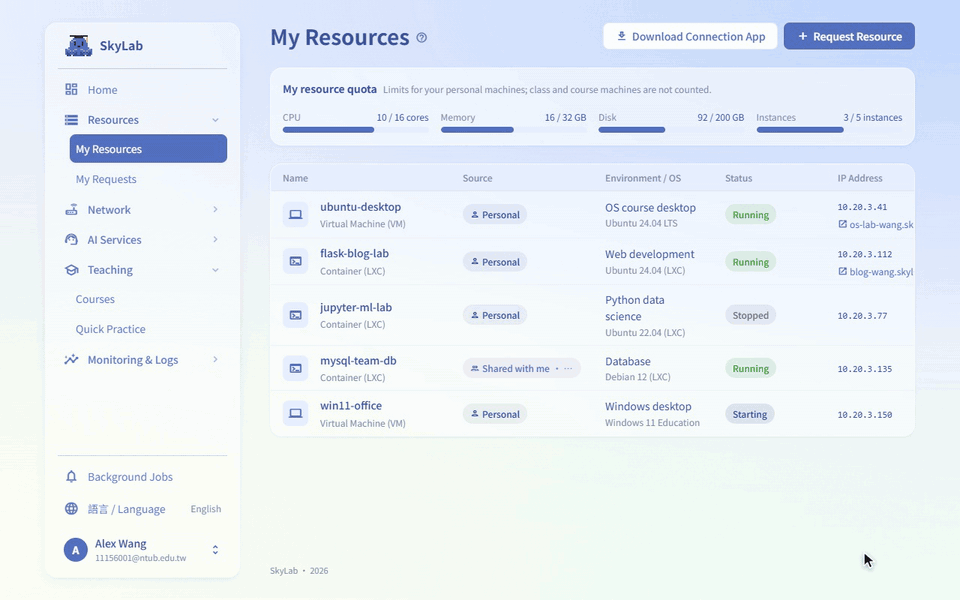
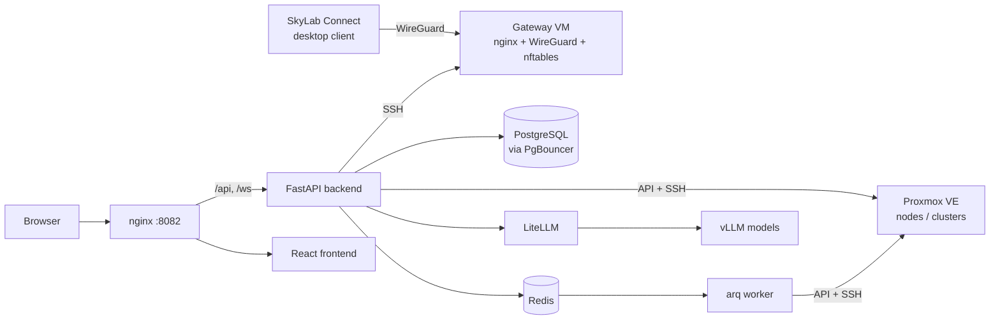
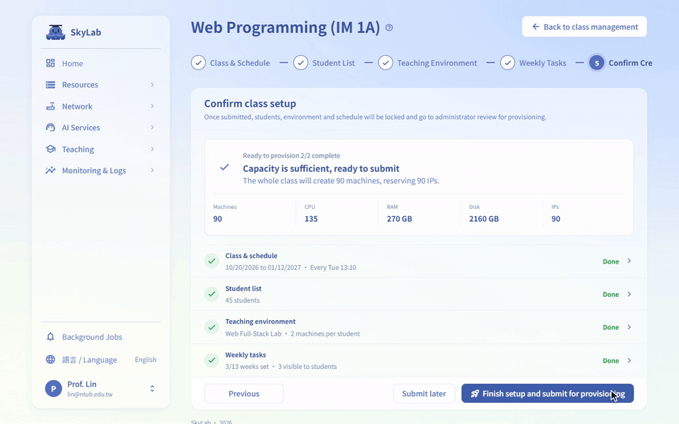
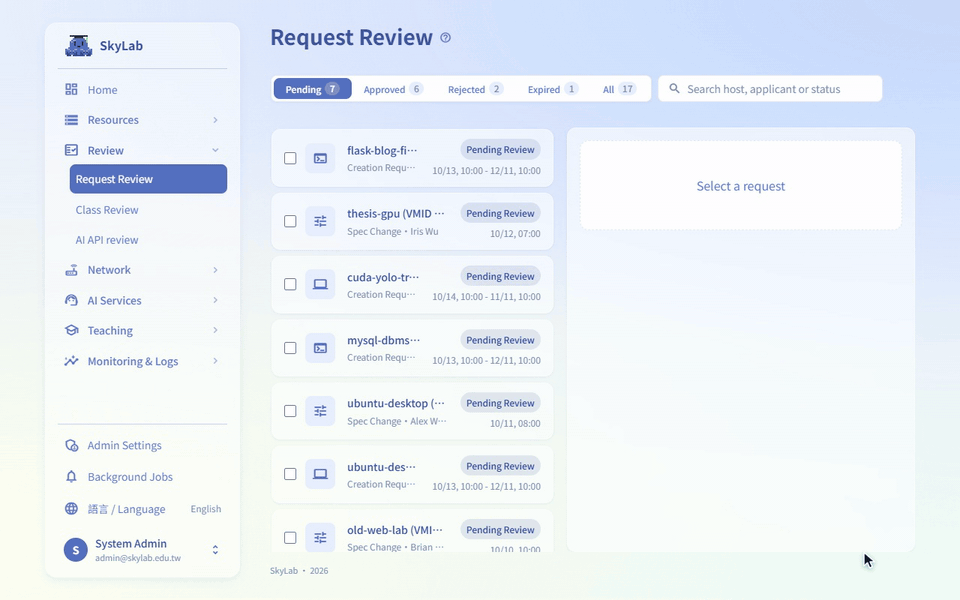
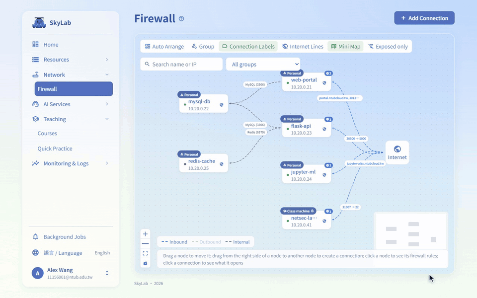

# SkyLab

> **English** | [繁體中文](website/zh-TW/overview.md)

**A self-hosted cloud for schools: students request VMs, teachers spin up whole classrooms, admins keep Proxmox VE under control.**

[](https://github.com/ntubclass/SkyLab/actions/workflows/backend-tests.yml)
[](https://github.com/ntubclass/SkyLab/actions/workflows/frontend-tests.yml)
[](https://github.com/ntubclass/SkyLab/actions/workflows/codeql.yml)
[](LICENSE)

SkyLab is a full-stack management platform for Proxmox VE (PVE) built for campus use. It covers VM/LXC lifecycle management, request and approval workflows, class-based batch provisioning, firewall and gateway control, AI-assisted operations, and an OpenAI-compatible AI API backed by self-hosted vLLM models.

**Who it is for:** schools, departments and labs that already run (or plan to run) Proxmox VE and want to hand out machines to students and courses without giving everyone access to the PVE web UI.

<p align="center">
  
</p>

## Architecture



## Components

| Component | Path | Role |
| --- | --- | --- |
| Backend | `backend/` | FastAPI + SQLModel + PostgreSQL + Redis; talks to the Proxmox API and serves REST + WebSocket |
| Frontend | `frontend/` | React 19 (JSX) + Vite + react-router-dom 7 + SCSS Modules; hand-written API services |
| nginx | `nginx/` | Single entry point (`:8082` by default): `/api`, `/ws` → backend, everything else → frontend |
| Gateway installer | `gateway/` | `install.sh` for the campus egress gateway VM: nginx (port forwarding, domain reverse proxy), WireGuard, nftables ACL |
| Desktop client | `desktop-client/` | SkyLab Connect (Electron): device login and WireGuard tunnel to the gateway |
| vLLM service | `vllm-service/` | Single-model service, multi-model vLLM cluster and the LiteLLM gateway that exposes them |
| Monitoring stack | `monitoring/` | Optional Prometheus / Grafana / Loki / Alloy / InfluxDB profile |
| Documentation | `website/` | All guides, the user manual and the API reference, as a VitePress site at [docs.skylab-tw.com](https://docs.skylab-tw.com) deployed to Cloudflare Pages; index in [`website/guides/index.md`](website/guides/index.md), site setup in [`website/README.md`](website/README.md) |
| Public site | `site/` | The introduction site at [skylab-tw.com](https://skylab-tw.com) with contact details, prerendered in three languages and deployed to Cloudflare Pages; see [`website/operations/site.md`](website/operations/site.md) |

## Tech stack

- **Backend:** FastAPI, SQLModel, Alembic, PostgreSQL (via PgBouncer), Redis, arq worker, proxmoxer, Paramiko, PyJWT, cryptography, httpx, websockets, Sentry
- **Frontend:** React 19 (React Compiler), Vite, react-router-dom 7, TanStack Query / Table / Virtual, SCSS Modules, react-i18next (en / zh-TW / ja), noVNC, xterm.js, @xyflow/react, Recharts, Monaco Editor, sonner, Vitest
- **Infrastructure:** Docker Compose, nginx, PgBouncer, PostgreSQL, Redis, MailCatcher (dev), optional Prometheus / Grafana / Loki / Alloy / InfluxDB
- **AI:** vLLM (OpenAI-compatible API) behind LiteLLM, plus built-in placement advice and template recommendation in the backend
- **Package managers:** uv (Python), Bun (frontend)

## Main features

- VM / LXC lifecycle: create, inspect, resize, snapshot, backup/restore, delete
- VNC and LXC terminal in the browser through WebSocket proxies (noVNC + xterm.js)
- VM request workflow: student submits → review → capacity check for the requested time window → scheduled provisioning
- Templates, teaching classes, timetables, student rosters, multi-machine teaching environments and whole-class batch provisioning
- Classroom monitoring, teacher broadcast and AI-assisted grading inside a class
- Firewall topology, NAT, reverse proxy (domain) rules, IP management, and a gateway VM managed over SSH (nginx port forwarding / domain reverse proxy / administrator-supplied HTTPS certificate / WireGuard)
- Multiple Proxmox connections (standalone nodes or clusters) with HA failover inside a cluster
- Governance: TTL-based reclamation, idle detection, resource alerts, mining detection, quotas
- AI API: `ccai_*` credentials, request approval, Redis sliding-window rate limiting, and an OpenAI-compatible proxy at `/api/v1/ai-proxy/{models,chat/completions,completions,responses}` that forwards to a restricted LiteLLM service key
- AI assistants for administrators (PVE operations) and for teaching workflows (navigation, contextual help, template recommendation)
- Authentication: password, Google, LDAP/AD, optional per-account TOTP, Cloudflare Turnstile, login pre-flight service check
- Platform health monitoring, system alerts, Web Push notifications, Prometheus `/metrics`
- Full audit log; roles: student / teacher / admin; trilingual UI (en / zh-TW / ja)

## See it in action

**A whole class at once.** The teacher submits the class; every student's machines are built, and the class opens on a live usage heatmap.



**Request, approve, provision.** An administrator approves a student's request, and the machine shows up in the student's list on its own.



**Networking by drag and drop.** Drawing a line between two machines on the map writes the firewall rules for that connection.



These clips are recorded from the real interface with mock data by `website/scripts/manual-shots/clips.mjs`.

## Requirements

- A Linux host with Docker Engine and Docker Compose ≥ 2.20 (the root compose file uses `include`)
- A reachable Proxmox VE node or cluster to provision machines; the UI, authentication and most tests work without one
- Optional: a Debian 13 VM to act as the gateway (port forwarding, domains, WireGuard), and GPU hosts running vLLM for the AI features

## Quick start (Docker Compose)

```bash
git clone https://github.com/ntubclass/SkyLab.git
cd SkyLab
cp -n .env.example .env
cp -n vllm-service/litellm/.env.example vllm-service/litellm/.env   # Compose reads this file even without the AI stack
# edit .env: at least SECRET_KEY, FIRST_SUPERUSER, FIRST_SUPERUSER_PASSWORD and POSTGRES_PASSWORD
docker compose up -d --build --scale litellm=0
```

`--scale litellm=0` leaves out the included LiteLLM service, which cannot start until the AI stack has generated its `config.yaml` (see below). Then open http://localhost:8082. On first launch the setup wizard (`/setup`) creates the administrator, tests the Proxmox connection, and configures the IP subnet, gateway and platform entry.

Default URLs (everything except the nginx entry point is bound to 127.0.0.1):

| Service | URL |
| --- | --- |
| SkyLab entry point (nginx) | http://localhost:8082 |
| Frontend container (built bundle, bypassing nginx) | http://localhost:5173 |
| Backend API | http://localhost:8000 |
| Swagger UI | http://localhost:8000/docs |
| MailCatcher (dev inbox; set `SMTP_HOST` in production) | http://localhost:1080 |
| Grafana (only with `--profile monitoring`) | http://localhost:8082/grafana/ |

### Optional: AI stack

The root `docker-compose.yml` already includes LiteLLM. To enable the AI features, start your vLLM models first (`vllm-service/start_multi_model_cluster.sh`), then let the helper script fill in the keys and wire everything up; upstream keys, model routing and `models.json` are explained in the [AI API User Manual](website/guides/ai-api-user-manual.md):

```bash
bash scripts/prepare-ai-stack.sh --init-env   # fill in missing keys in both .env files
bash scripts/prepare-ai-stack.sh --start      # generate the LiteLLM config, create its database, issue the service key, start everything
```

For production deployment (platform entry, HTTPS, LDAP, CI) see [`website/guides/deployment.md`](website/guides/deployment.md).

## Local development

Backend:

```bash
cd backend
uv sync                            # the virtual environment is created in the repository root (.venv)
uv run fastapi dev app/main.py     # http://localhost:8000, Swagger UI at /docs
```

Frontend:

```bash
cd frontend
bun install
bun run dev                        # http://localhost:5173, /api proxied to :8000
```

The backend has no generated client. Every endpoint is wrapped by hand in `frontend/src/services/*.js` and covered by a Vitest mock test; update the matching service file whenever a route changes.

See [`website/guides/development.md`](website/guides/development.md) for the full guide and [`website/guides/backend.md`](website/guides/backend.md) for the backend layout.

## Database migrations

Schema changes are managed with Alembic. Every change to `backend/app/models/` needs a migration. Generate it on the host: the backend container has no source mount, so a file written there never reaches your checkout.

```bash
cd backend
export POSTGRES_SERVER=localhost POSTGRES_PORT=5433   # the db container's host port (POSTGRES_HOST_PORT)
uv run alembic revision --autogenerate -m "Describe the change"
uv run alembic upgrade head
```

The `prestart` container runs `alembic upgrade head` automatically when the stack starts.

## Tests

- **Backend:** `uv run bash ./scripts/test.sh` from `backend/` (pytest; coverage report in `backend/htmlcov/`). The tests are not part of the backend image, so they run on the host, not inside the container.
- **Frontend:** `bun run test` from `frontend/` (Vitest)
- **CI:** GitHub Actions runs backend tests, frontend tests, desktop client tests, AI service tests, a migration check and CodeQL

## Proxmox configuration

Proxmox connections are **not** configured in `.env`. Enter them in the setup wizard on first install, then add, edit or sync them on the "PVE Management" page; credentials are encrypted and stored in the database. Several PVE entry points (standalone nodes or clusters) can be attached at once, and hosts inside a cluster fail over automatically (TCP ping).

## Documentation

Everything lives under [`website/`](website/) and is published as the documentation site (see [`website/README.md`](website/README.md) for the build and the Cloudflare Pages deployment). The index is [`website/guides/index.md`](website/guides/index.md); 繁體中文 pages are under `website/zh-TW/`. Most-used entries:

- [`website/getting-started.md`](website/getting-started.md) — from `docker compose up` to the setup wizard and the first login
- [`website/manual/`](website/manual/index.md) — the user manual, one page per feature, grouped by role (students, teachers, administrators)
- [`website/guides/development.md`](website/guides/development.md) — development environment
- [`website/guides/deployment.md`](website/guides/deployment.md) — production deployment, platform entry, HTTPS certificate, LDAP
- [`website/operations/upgrade.md`](website/operations/upgrade.md), [`website/operations/backup.md`](website/operations/backup.md) — upgrading, migrations, backup and restore
- [`website/guides/monitoring.md`](website/guides/monitoring.md) — built-in health monitoring and the optional monitoring stack
- [`website/guides/ai-api-user-manual.md`](website/guides/ai-api-user-manual.md) — LiteLLM deployment and the user-facing AI API
- [`website/guides/multi-machine-environment-sop.md`](website/guides/multi-machine-environment-sop.md) — SOP for multi-machine teaching environments
- [`website/troubleshooting.md`](website/troubleshooting.md) — known failures, causes and fixes

## Community

- **Questions and bug reports:** [GitHub Issues](https://github.com/ntubclass/SkyLab/issues) (please use the templates)
- **Contributing:** read [`CONTRIBUTING.md`](CONTRIBUTING.md); all commits need a DCO sign-off (`git commit -s`)
- **Security issues:** do not open a public issue; follow [`SECURITY.md`](SECURITY.md)
- **Code of conduct:** [`CODE_OF_CONDUCT.md`](CODE_OF_CONDUCT.md)

## License

SkyLab is released under the **GNU Affero General Public License v3.0** (see [`LICENSE`](LICENSE)).

- Running SkyLab inside your school or organisation, with or without local changes, carries no obligation beyond the license itself.
- If you modify SkyLab and let third parties use it over a network (for example as a hosted or managed service), the AGPL requires you to make your modified source available to those users.
- **Commercial licensing** is available for organisations that want to offer SkyLab as a service without the AGPL's source-sharing terms, or need other terms. Open an issue or contact the maintainers to discuss.

The project started from the MIT-licensed Full Stack FastAPI Template, and the desktop client from an MIT-licensed Electron + Vue template; their notices are kept in [`NOTICE`](NOTICE), and the open-source components SkyLab is built on are listed in [`THIRD_PARTY_NOTICES.md`](THIRD_PARTY_NOTICES.md). The same information is shown in the application under Account Settings → About. "SkyLab" and the SkyLab logo are names of this project; the license covers the code, not the name.
