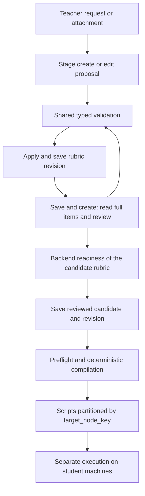

# Teacher Judge proposal, persistence and compilation contract

English | [繁體中文](teacher-judge-contract.zh-TW.md)

## Data and execution boundaries

`TeacherJudgeFile.analysis_json` is the persisted rubric, guarded by
`analysis_revision`. AI tools stage proposals; staging does not save the rubric,
and saving does not execute anything on student machines.



Save and create flushes autosave, reviews the saved revision, saves the reviewed
candidate, and uses its new revision to create scripts. Failed writes and revision
conflicts stop compilation. The frontend uses backend `script_ready`; a model's
success claim cannot authorize compilation.

## One new-write format

Create, edit, attachment consolidation and direct persistence use
`TeacherJudgeTypedCheckStep`:

```json
{
  "id": "file.content",
  "title": "Read assignment file",
  "collector": {"type": "file_text", "path": "/root/test/test.txt"},
  "assertion": {"type": "text_contains", "expected": "hello"}
}
```

- Collectors gather evidence; assertions evaluate it. `judgement_mode=ai` requires
  a compatible assertion; `teacher` omits it.
- New tool arguments reject flat `argv`, `command_key`, `parameters` and `cwd`,
  including `cwd: null`. The command catalog describes capabilities only.
- `file_text.path`, `file_stat.path` and recognized command file/program operands
  require absolute paths. `cat /root/test/test.txt` and `python3 /srv/main.py`
  are locatable; relative paths, `~`, or a working directory plus relative input
  cannot produce executable plans. Unlocated requirements remain incomplete.
- Executable names such as `cat` and `python3` may use PATH. Version and service
  queries do not require invented file locations.
- Paths belong to the student machine identified by `target_node_key`, not the
  backend host. P1/P2 labels resolve to stable class-local node keys. Two machines
  may use the same `/root/test/test.txt`; node names are not prefixed to paths.
- Contract validation performs no remote existence, content or permission checks.

## Entry points and ownership

| Entry point | Responsibility and source of truth |
| --- | --- |
| Model/API step schema | Typed model in `schemas.py`; stored-data readers expose that same JSON schema |
| `list_checklist` | Index only; does not count as reading execution details |
| `get_checklist_item` | Full item and backend `execution_readiness`; required before editing |
| Create/edit tools | Validate raw steps before normalization, then call `typed_item_issues()`; never silently drop malformed steps |
| Attachment consolidation | Call `typed_item_issues()` again to catch merged item and per-node step ID conflicts |
| Persistence | `file_service.py` calls `analysis_write_issues()` and performs a database revision comparison |
| Final review/preflight | `get_script_generation_blockers()` checks the candidate rubric and distinguishes missing input from contract errors |
| Compilation | `canonicalize_check_plan()` validates the plan; the deterministic compiler emits scripts without cwd |
| Frontend | Displays stored items and backend results; historical formats prompt review without another command-readiness implementation |

## Missing input and analysis errors

Full-table review forces `list_checklist` only until the initial index read
succeeds, then switches to `tool_choice=auto`. The model may inspect and edit
an item, ask for missing information, or explain why no changes are needed.
Index-only review must not claim execution details were checked; zero proposals
does not establish that the rubric passed review.

Exhausting tool rounds explicitly requests a final explanation. An empty model
response without tool calls gets one corrective generation only when completion
usage is known and budget remains, within the original call's time and token
limits. Prior tool results are retained without replaying tools; recovered usage
includes the empty generation. Repeated emptiness, exhausted budgets, or invalid
response structures fail rather than defaulting to a successful review.

| Condition | Handling |
| --- | --- |
| Unlocated file or unknown date/service scope | Ask for the actual missing information; do not guess |
| Absolute collector path contradicts a path gap | `check_plan_contract_invalid`; model repair, `teacher_input_required=false` |
| Located plan with an invalid or absent assertion | Repair the assertion contract, not the file location |
| No safe evidence collection | Unsupported; do not substitute an unrelated executable check |
| Unresolved tool error/rejected/duplicate | Block final compilation; resolved outcomes no longer block |

Location completeness is independent of other compiler errors. One incomplete
item cannot hide contract errors on another. Final workflow text comes from
backend blockers rather than an appended free-form model summary.

Edits preserve omitted fields, including `missing_information`. Replacing steps
or setting `detectable=auto` does not clear old gaps. Explicitly remove resolved
gaps and preserve unrelated dates, services and scopes.

Finalizer additionally protects known locations for the same node/item/step. It
rejects replacement of an absolute input with an unresolved relative input. It
only clears obsolete deterministic location-gap text resolved by the current
steps. Other path claims require model reconciliation; keyword matching never
silently deletes teacher intent, and locations cannot be borrowed across machines.

## Historical data

Stored flat/catalog steps and nonempty cwd remain readable. Metadata-only changes
can preserve an unchanged historical plan. Changing its execution plan, judgement
or gaps requires the current format. Stored-data parsing is not a proposal bypass.

Plans containing cwd cannot create new scripts. Review may use the same item's
known information to form absolute paths; unknown information remains unresolved.
Existing script artifacts are not rewritten and must be recreated to use the new
compiler.

## Verification and incident diagnosis

Core regressions are in `test_absolute_path_contract.py`,
`test_contract_convergence.py` and `test_finalizer_path_conflicts.py`: path conflicts,
direct persistence, multiple nodes, historical data and mixed errors.

```powershell
# backend/
uv run python -m pytest tests/ai/teacher_judge tests/test_teacher_judge_automation_support.py tests/test_teacher_judge_convergence.py tests/test_teacher_judge_boundaries.py tests/test_teacher_judge_files.py tests/test_teacher_judge_attachments.py -q
# frontend/
bun run test src/pages/course-operations/class-workspace/AiJudgePanel.test.jsx src/pages/course-operations/class-workspace/AiJudgePanel.saveAndBuild.test.jsx src/pages/course-operations/class-workspace/AiJudgePanel.autosave.test.jsx src/services/aiJudge.test.js
```

Local tests use scripted models and isolated SQLite, not production PostgreSQL,
live models or student VMs. Diagnose incidents using the deployed version, source
file ID/revision, tool arguments/outcomes, `target_node_key`, collector,
`missing_information`, `reason_code` and `script_ready`. Before an artifact exists,
trace proposals and review. After actual execution fails, inspect the VM's file
and permission results. Never log credentials, SSH passwords or student file content.
