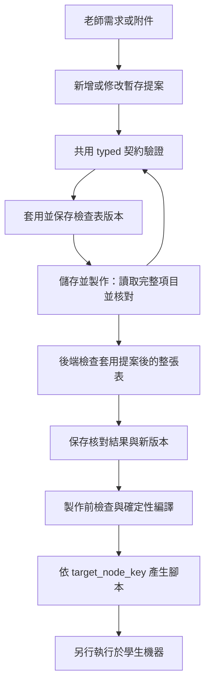

# Teacher Judge 提案、儲存與製作契約

[English](teacher-judge-contract.md) | 繁體中文

## 資料與執行邊界

檢查表的持久化來源是 `TeacherJudgeFile.analysis_json`，版本由
`analysis_revision` 管理。AI 工具先建立暫存提案；工具成功不等於已儲存，
儲存成功也不等於已在學生機器執行。



「儲存並製作」先 flush autosave，使用已保存版本核對，再保存核對結果，
最後帶著新版本建立腳本。任何儲存失敗或版本衝突都不能繼續製作。
前端顯示後端的 `script_ready`；模型說「完成」不構成製作授權。

## 單一新寫入格式

新增、修改、附件合併與直接儲存的新步驟都使用
`TeacherJudgeTypedCheckStep`：

```json
{
  "id": "file.content",
  "title": "讀取作業檔案",
  "collector": {"type": "file_text", "path": "/root/test/test.txt"},
  "assertion": {"type": "text_contains", "expected": "hello"}
}
```

- `collector` 描述如何取得證據，`assertion` 描述如何判定；`judgement_mode=ai`
  必須有相容的 assertion，`teacher` 模式省略 assertion。
- 新工具參數不接受 flat `argv`、`command_key`、`parameters` 或 `cwd`，包括
  `cwd: null`。command catalog 只提供能力參考，不是第二種提案格式。
- `file_text.path`、`file_stat.path` 與已辨識的命令檔案／程式參數必須是絕對路徑。
  `cat /root/test/test.txt`、`python3 /srv/main.py` 可定位；`cat test.txt`、`~`
  或工作目錄加相對路徑不能形成可製作的步驟。尚未定位的需求維持缺資料，不能執行。
- `cat`、`python3` 這類可執行檔名稱可由 PATH 尋找。版本／服務查詢不需要捏造檔案路徑。
- 絕對路徑屬於 `target_node_key` 指向的學生機器；不對應 backend 主機的檔案系統。
  P1／P2 是顯示標籤，後端轉成班級內穩定的 node key。兩台機器可使用相同的
  `/root/test/test.txt`，不需要把機器名稱接到路徑前面。
- 契約驗證不連線檢查檔案是否存在、內容或權限；這些要到實際執行才能確認。

## 各入口的責任

| 入口 | 責任與 source of truth |
| --- | --- |
| 模型與 API 的步驟 schema | `schemas.py` 的 typed 模型；歷史讀取模型的 JSON schema 也引用同一模型 |
| `list_checklist` | 只提供索引，不代表已讀過路徑或步驟 |
| `get_checklist_item` | 提供完整項目及後端 `execution_readiness`；修改既有項目前必須呼叫 |
| 新增／修改工具 | `service.py` 先驗證原始步驟，再呼叫 `typed_item_issues()`；不得先丟棄壞步驟後宣稱成功 |
| 附件提案合併 | 再以 `typed_item_issues()` 檢查合併後的項目與同節點 step ID 衝突 |
| 檢查表儲存 | `file_service.py` 以 `analysis_write_issues()` 驗證變更，再以資料庫版本比較保存 |
| 最後核對與製作前檢查 | `get_script_generation_blockers()` 判斷整張候選表；缺資料與格式錯誤分開回報 |
| 腳本編譯 | `canonicalize_check_plan()` 驗證完整計畫，再由確定性編譯器產生腳本，不傳入 cwd |
| 前端 | 顯示保存的項目與後端結果；舊格式只提示待核對，不自行判斷命令是否可執行 |

## 缺資料、分析錯誤與修正

| 情況 | 處理 |
| --- | --- |
| 檔案沒有可定位的絕對路徑、日期或服務範圍未指定 | 詢問實際缺少的資訊，不猜值 |
| 步驟有絕對路徑，但 `missing_information` 又聲稱缺路徑 | `check_plan_contract_invalid`；要求模型核對，`teacher_input_required=false` |
| 路徑完整，但 assertion 缺失或格式不合法 | 修正判定契約，不能把這個錯誤改說成缺少路徑 |
| 無安全取證方式 | unsupported；不以無關的可執行步驟替換需求 |
| 未解決的工具 error／rejected／duplicate | 阻擋最後製作；已明確 resolved 的工具錯誤不再阻擋 |

路徑完整性不以整個項目通過編譯為前提。一個項目缺資料，也不能遮住其他
項目的編譯錯誤。最終回覆由後端實際 blockers 組成，不拼接模型自由文字的缺口摘要。

edit 的省略欄位維持原值，包括 `missing_information`。
只更換 `check_steps` 或設定 `detectable=auto` 不會清空舊缺口；模型必須明確
移除已解決的缺口，保留日期、服務等其他需求。

Finalizer 另有保護既有項目的限制：同一機器、項目、步驟的已知絕對路徑不能退回
無法定位的相對路徑；只能清除已被目前步驟解決的、系統固定產生的舊位置缺口。
其他路徑說法交回模型修正，不靠關鍵字直接刪除老師需求，也不能借用別台機器的位置。

## 歷史資料

歷史 flat／catalog 步驟與非空 cwd 保留讀取，避免遺失舊的定位資訊。
只變更顯示名稱等中繼資料時，可原樣保存未改動的歷史計畫；一旦改動執行計畫、
判定方式或缺口，必須改成目前格式。歷史讀取能力不是新提案的驗證例外。

含 cwd 的舊計畫不能直接製作新腳本。核對時只能依同一項目已知資訊轉成絕對路徑；
資料不足就保留缺口。已產生的歷史腳本不會被此次修改改寫，必須重新製作才會使用新編譯器。

## 驗證與現場診斷

主要回歸案例在 `test_absolute_path_contract.py`、`test_contract_convergence.py`、
`test_finalizer_path_conflicts.py`，涵蓋路徑矛盾、直接儲存、跨節點、歷史資料與混合錯誤。

```powershell
# backend/
uv run python -m pytest tests/ai/teacher_judge tests/test_teacher_judge_automation_support.py tests/test_teacher_judge_convergence.py tests/test_teacher_judge_boundaries.py tests/test_teacher_judge_files.py tests/test_teacher_judge_attachments.py -q
# frontend/
bun run test src/pages/course-operations/class-workspace/AiJudgePanel.test.jsx src/pages/course-operations/class-workspace/AiJudgePanel.saveAndBuild.test.jsx src/pages/course-operations/class-workspace/AiJudgePanel.autosave.test.jsx src/services/aiJudge.test.js
```

本機測試使用 scripted model 與隔離 SQLite；它們不是正式 PostgreSQL、真實模型或學生
VM 的驗證。現場重現時對照部署版本、來源檔案 ID／revision、工具參數與結果、
`target_node_key`、`collector`、`missing_information`、`reason_code`、`script_ready`。
若尚未產生 artifact，先追提案與核對；已有 artifact 且實際讀檔失敗，才追 VM 上的檔案與權限。
紀錄不得包含憑證、SSH 密碼或學生檔案內容。
