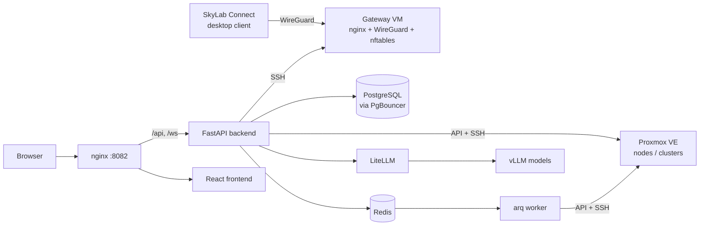

# Concepts and architecture

SkyLab sits between people and a Proxmox VE installation. Users never see the PVE web UI; they see machines, requests, classes and courses. This page explains the components that make that happen, the roles, and the vocabulary used in the UI and in the guides.

## Architecture

| Component | Where | Role |
| --- | --- | --- |
| nginx | `nginx/`, container `nginx` | The only public entry point. Routes `/api` and `/ws` to the backend, `/grafana/` to Grafana, everything else to the frontend. Generates the request id that appears in logs and in the `X-Request-ID` header. |
| Backend | `backend/`, containers `backend`, `worker`, `prestart` | FastAPI + SQLModel. REST under `/api/v1`, WebSocket endpoints for consoles and live updates, three background loops, and an arq worker for long jobs. |
| Frontend | `frontend/`, container `frontend` | React 19 single-page app with hand-written API services, three languages (English, 繁體中文, 日本語), VNC and terminal consoles. |
| Database | containers `db`, `pgbouncer` | PostgreSQL behind PgBouncer in transaction-pooling mode. Credentials stored here are encrypted with a key derived from `SECRET_KEY`. |
| Redis | container `redis` | Login rate limiting, token revocation, the arq queue, scheduler heartbeats and short-lived caches. |
| Proxmox VE | your nodes or clusters | Where machines actually run. SkyLab uses the PVE API for almost everything and SSH to a node for the LXC terminal and `pct` commands. |
| Gateway VM | a Debian 13 VM you provide | nginx (stream and http) for port forwarding, domain reverse proxy and the platform entry; WireGuard for the desktop client; nftables for access control. SkyLab manages it over SSH. |
| LiteLLM and vLLM | `vllm-service/` | The AI gateway and the self-hosted models behind the OpenAI-compatible AI API and the built-in assistants. |
| Monitoring stack | `monitoring/`, Compose profile `monitoring` | Optional Prometheus, Grafana, Loki, Alloy and InfluxDB. Collection and dashboards only; SkyLab's own alerts come from the backend. |

## How a request becomes a machine

1. A student fills in a **VM request**: template, size, time window, login password. Quotas cap the form; the password is kept only as a hash (Windows excepted, see [Where data lives](#where-data-lives)).
2. A reviewer approves it. SkyLab checks GPU and capacity for the requested window before it accepts the approval.
3. The **scheduler** (a 60-second loop in the backend) notices that the window has started and enqueues a provisioning job. The job id is unique per request, so a request is never built twice.
4. The **worker** clones the platform template on the chosen node, allocates a static IP from the IP subnet, writes user, password hash and network into cloud-init, applies the firewall rules and starts the guest. Concurrency is limited by the governance configuration.
5. The machine appears under **My Resources** with its login user, console, snapshots and backups. At the end of the window, or when the TTL expires, governance stops or reclaims it.

Teaching classes and multi-machine environments go through the same worker in batches; a batch task record tracks every machine.

## Roles

| Role | What they can do |
| --- | --- |
| **Student** | Request machines, use the consoles, manage the firewall rules of their own machines, extend expiry, join classes and courses, use quick practice environments, request an AI API credential. Class machines handed out by a teacher are read-only for firewall changes. |
| **Teacher** | Everything a student can do, plus: create platform templates, classes with rosters and timetables, batch provisioning, classroom monitoring and broadcast, multi-machine teaching environments, courses with weekly content, and AI-assisted checking of student work. |
| **Administrator** (superuser) | Everything, plus: PVE connections, IP management, the gateway VM, governance, quotas, request review, user and LDAP administration, AI API approval and model configuration, audit log, monitoring and system alerts. Administrators are not subject to quotas. |

Authentication can be local password, Google, or LDAP / Active Directory. Two-step verification (TOTP) is enabled per account and can be required by an administrator. Cloudflare Turnstile protects the login and registration forms when both keys are configured.

## Vocabulary

| Term | Meaning |
| --- | --- |
| **Resource** | A VM or LXC container managed by SkyLab. Identified by its PVE `vmid`; carries an owner, an expiry date, a login user and a source badge (personal, shared, teaching class, quick practice or course). |
| **Platform template** | A VM or container marked as a template in SkyLab's database. It is not converted on the PVE side (thick-provisioned LVM cannot hold PVE templates); SkyLab protects the source machine and full-clones it. Whether the login password can be set depends on cloud-init being present in the image. |
| **PVE connection** | One Proxmox API endpoint: a standalone node or a cluster. Pool, storages, default node, gateway IP and local subnet are configured per connection; the PVE bridge belongs to the IP subnet. Clones never cross connections. |
| **IP subnet** | The range from which static addresses are allocated. CIDR, gateway and DNS always come from the IP management service; there is no silent fallback to DHCP. |
| **VM request** | A student's application for a machine with a time window. Approval reserves capacity; the scheduler provisions at the start of the window. Extending the expiry also extends the approved window. |
| **Spec change request** | A request to resize or extend an existing machine. Pending increments count against the quota. |
| **Teaching class** | A roster of students with a timetable. A teacher can provision one machine per student in a batch and watch or broadcast to the class from the classroom view. |
| **Multi-machine teaching environment** | A reusable topology of several machines with their network, built by a teacher and published either as a quick practice environment for self-service or as the environment of a formal class. See the [SOP](/guides/multi-machine-environment-sop). |
| **Quick practice** | A published environment that any student can launch for a limited session without a request. |
| **Course** | A learning path with weekly content, progress tracking and optional lab machines; teachers can run AI-assisted checks on student work. |
| **Gateway VM** | The campus egress host managed by SkyLab over SSH. Provides WireGuard access, port forwarding, domain reverse proxy and the platform entry. |
| **Platform entry** | SkyLab itself exposed on a domain through the gateway's nginx with an administrator-supplied certificate; optionally proxied through Cloudflare. |
| **Firewall topology** | The per-machine and per-class rules SkyLab applies on PVE, visualised as a graph. Teachers see their students' machines; students see their own. |
| **Governance configuration** | One settings object controlling TTL reclamation, idle detection, resource alerts, mining detection, provisioning concurrency and snapshot and backup limits. See [Governance configuration](/reference/governance-config). |
| **Quota** | Limits on CPU, memory, disk and machine count: a global default with per-user overrides. Request forms are capped by the remaining quota. |
| **Job** | A task record for background work (clone, batch provisioning, reset, deletion) shown on the Background Jobs page and pushed live over WebSocket and Web Push. |
| **AI API credential** | A `ccai_*` key requested by a user and approved by an administrator. Requests to `/api/v1/ai-proxy/*` are forwarded to a restricted LiteLLM service key with sliding-window rate limits. |
| **SkyLab Connect** | The Electron desktop client that logs a device in and opens a WireGuard tunnel to the gateway so that machines on the lab network are reachable from anywhere. |

## Background work

The backend runs three loops under a PostgreSQL advisory lock, so with several replicas only one process runs each loop:

- **Scheduler** (every 60 seconds): request start and stop, scheduled boot and auto-stop, the deletion queue, quick practice lifecycle, resource alerts, TTL lifecycle, idle detection, mining detection, snapshot cleanup and system health alerts.
- **Web Push notifier**: delivers task notifications to the browsers of the task owner.
- **WireGuard reconciler**: keeps the peers on the gateway in step with the database.

Long operations (template conversion, cloning, batch provisioning, one-click reset, deletion) run in the arq worker. With `REDIS_ENABLED=false` they run inside the backend process instead, which is only meant for development.

## Where data lives

| Data | Store |
| --- | --- |
| Users, requests, resources, classes, courses, firewall rules, audit log, settings | PostgreSQL |
| PVE, LDAP and gateway credentials, TOTP secrets, system-generated machine passwords | PostgreSQL, encrypted with a key derived from `SECRET_KEY` |
| User-chosen machine passwords | Only as a SHA-512 crypt hash; they cannot be shown again, only reset. For Windows the password is held encrypted until the machine is built, then cleared |
| Rate limits, revoked tokens, queue, heartbeats | Redis |
| Machine disks, snapshots, backups | Proxmox VE storage |
| Metrics and logs (optional) | Prometheus, Loki and InfluxDB in the monitoring profile |

Back up the PostgreSQL volume and keep `SECRET_KEY` with it; one without the other is useless.
