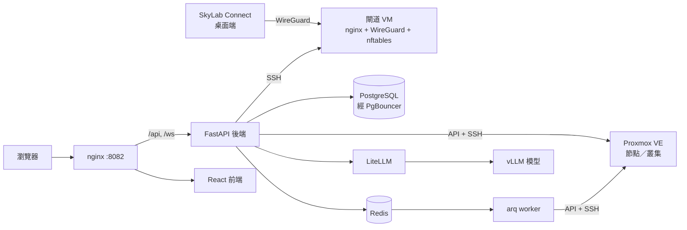

# 概念與架構

SkyLab 站在使用者與 Proxmox VE 之間。使用者看不到 PVE 的網頁介面，看到的是機器、申請單、班級與課程。本頁說明讓這件事成立的各個元件、角色，以及介面與指南中使用的詞彙。

## 架構

| 元件 | 位置 | 角色 |
| --- | --- | --- |
| nginx | `nginx/`、容器 `nginx` | 唯一的對外入口。`/api` 與 `/ws` 轉到後端、`/grafana/` 轉到 Grafana、其餘轉到前端。產生日誌與 `X-Request-ID` 標頭裡的 request id。 |
| 後端 | `backend/`、容器 `backend`、`worker`、`prestart` | FastAPI + SQLModel。`/api/v1` 下的 REST、主控台與即時更新用的 WebSocket 端點、三個背景迴圈，以及跑長時間工作的 arq worker。 |
| 前端 | `frontend/`、容器 `frontend` | React 19 單頁應用，手寫 API service、三種語言（English、繁體中文、日本語）、VNC 與終端機主控台。 |
| 資料庫 | 容器 `db`、`pgbouncer` | PostgreSQL，前面是 transaction pooling 模式的 PgBouncer。存在這裡的憑證以 `SECRET_KEY` 衍生的金鑰加密。 |
| Redis | 容器 `redis` | 登入速率限制、token 撤銷、arq 佇列、排程器心跳與短期快取。 |
| Proxmox VE | 你的節點或叢集 | 機器實際運行的地方。SkyLab 幾乎所有操作都走 PVE API，LXC 終端機與 `pct` 指令則 SSH 到節點。 |
| 閘道 VM | 你提供的一台 Debian 13 VM | nginx（stream 與 http）負責埠轉發、網域反向代理與平台入口；WireGuard 給桌面端連入；nftables 做存取控制。SkyLab 經 SSH 管理它。 |
| LiteLLM 與 vLLM | `vllm-service/` | OpenAI 相容 AI API 與內建助手背後的 AI 閘道與自架模型。 |
| 監控 stack | `monitoring/`、Compose profile `monitoring` | 選用的 Prometheus、Grafana、Loki、Alloy 與 InfluxDB。只做收集與呈現；SkyLab 自己的告警來自後端。 |

## 一張申請單如何變成一台機器

1. 學生填寫**機器申請**：範本、規格、使用時段、登入密碼。配額限制表單上限；密碼只存雜湊（Windows 例外，見[資料放在哪裡](#資料放在哪裡)）。
2. 審核者核准。SkyLab 在接受核准前先檢查該時段的 GPU 與容量。
3. **排程器**（後端每 60 秒一輪的迴圈）發現時段開始，把建置工作入列。工作 id 對每張申請單唯一，所以同一張申請單不會被建兩次。
4. **worker** 在選定的節點克隆平台範本、從 IP 網段分配靜態位址、把使用者、密碼雜湊與網路寫進 cloud-init、套用防火牆規則並啟動機器。併發數由治理設定限制。
5. 機器出現在**我的資源**，附登入帳號、主控台、快照與備份。時段結束或 TTL 到期時，治理機制會停機或回收。

教學班級與多機環境走同一個 worker，只是以批次進行；每台機器都有一筆批次任務紀錄。

## 角色

| 角色 | 能做什麼 |
| --- | --- |
| **學生** | 申請機器、使用主控台、管理自己機器的防火牆規則、延期、加入班級與課程、使用快速練習環境、申請 AI API 憑證。老師發下來的班級機器，防火牆對學生唯讀。 |
| **老師** | 學生能做的全部，再加上：建立平台範本、含名單與課表的班級、批次建置、教室監看與廣播、多機教學環境、含每週內容的課程，以及 AI 輔助檢查學生作業。 |
| **管理員**（superuser） | 全部，再加上：PVE 連線、IP 管理、閘道 VM、治理、配額、申請審核、使用者與 LDAP 管理、AI API 審核與模型設定、稽核日誌、監控與系統告警。管理員不受配額限制。 |

登入方式可以是本地密碼、Google 或 LDAP／Active Directory。兩步驟驗證（TOTP）逐帳號啟用，管理員可以強制要求。兩把金鑰都設定時，Cloudflare Turnstile 會保護登入與註冊表單。

## 詞彙

| 詞彙 | 意思 |
| --- | --- |
| **資源** | SkyLab 管理的一台 VM 或 LXC 容器。以 PVE 的 `vmid` 識別；有擁有者、到期日、登入帳號與來源徽章（個人、共享、教學班級、快速練習或課程）。 |
| **平台範本** | 在 SkyLab 資料庫中標記為範本的 VM 或容器。PVE 端不做轉換（厚配置的 LVM 放不了 PVE 範本）；SkyLab 保護母機並以 full clone 複製。登入密碼能不能由平台設定，取決於映像裡有沒有 cloud-init。 |
| **PVE 連線** | 一個 Proxmox API 入口：單一節點或一個叢集。pool、storage、預設節點、Gateway IP 與本地子網都是逐連線設定；PVE bridge 屬於 IP 網段的設定。克隆不會跨連線。 |
| **IP 網段** | 分配靜態位址的範圍。CIDR、閘道與 DNS 一律來自 IP 管理服務，沒有無聲退回 DHCP 這回事。 |
| **機器申請** | 學生對一台機器與使用時段的申請。核准會預約容量；排程器在時段開始時建置。延期同時延長核准的時段。 |
| **規格調整申請** | 對既有機器調整規格或延期的申請。未套用的增量也算進配額。 |
| **教學班級** | 一份學生名單加上課表。老師可以批次替每位學生建一台機器，並從教室畫面監看或廣播。 |
| **多機教學環境** | 由老師建好、可重複使用的多台機器與網路拓樸，可發布成自助的快速練習環境，或作為正式班級的環境。見 [SOP](/zh-TW/guides/multi-machine-environment-sop)。 |
| **快速練習** | 已發布、任何學生不用申請就能啟動一段限時會話的環境。 |
| **課程** | 含每週內容、進度追蹤與選用實驗機的學習路徑；老師可以對學生作業執行 AI 輔助檢查。 |
| **閘道 VM** | SkyLab 經 SSH 管理的校園出口主機。提供 WireGuard 連入、埠轉發、網域反向代理與平台入口。 |
| **平台入口** | 把 SkyLab 本身經閘道的 nginx 掛到一個網域，憑證由管理員自備；可選擇經 Cloudflare 代理。 |
| **防火牆拓樸** | SkyLab 套用在 PVE 上的逐機器與逐班級規則，以圖形呈現。老師看得到自己學生的機器，學生看自己的。 |
| **治理設定** | 一份設定物件，控制 TTL 回收、閒置偵測、資源告警、挖礦偵測、建置併發數，以及快照與備份上限。見[治理設定欄位](/zh-TW/reference/governance-config)。 |
| **配額** | CPU、記憶體、磁碟與機器數的上限：一份全域預設值加上逐使用者的覆寫。申請表單以剩餘配額設限。 |
| **任務** | 背景工作（克隆、批次建置、重置、刪除）的紀錄，顯示在「背景任務」頁，並經 WebSocket 與 Web Push 即時推送。 |
| **AI API 憑證** | 使用者申請、管理員核准的 `ccai_*` 金鑰。對 `/api/v1/ai-proxy/*` 的請求會以受限的 LiteLLM service key 轉發，並有滑動視窗速率限制。 |
| **SkyLab Connect** | Electron 桌面端：讓裝置登入並對閘道開一條 WireGuard 隧道，讓實驗室網路上的機器從任何地方都連得到。 |

## 背景工作

後端在 PostgreSQL advisory lock 下跑三個迴圈，所以多副本時每個迴圈只有一個行程在跑：

- **排程器**（每 60 秒）：申請時段的開始與結束、排程開機與自動停機、刪除佇列、快速練習的生命週期、資源告警、TTL 生命週期、閒置偵測、挖礦偵測、快照清理與系統健康告警。
- **Web Push 推播**：把任務通知送到任務擁有者的瀏覽器。
- **WireGuard reconciler**：讓閘道上的 peer 與資料庫保持一致。

長時間操作（轉範本、克隆、批次建置、一鍵重置、刪除）在 arq worker 執行。`REDIS_ENABLED=false` 時改在後端行程內執行，只適合開發用。

## 資料放在哪裡

| 資料 | 儲存位置 |
| --- | --- |
| 使用者、申請單、資源、班級、課程、防火牆規則、稽核日誌、設定 | PostgreSQL |
| PVE、LDAP 與閘道憑證、TOTP 祕密、系統代發的機器密碼 | PostgreSQL，以 `SECRET_KEY` 衍生的金鑰加密 |
| 使用者自訂的機器密碼 | 只存 SHA-512 crypt 雜湊；無法再顯示，只能重設。Windows 的密碼會加密暫存到機器建好為止，之後清除 |
| 速率限制、已撤銷 token、佇列、心跳 | Redis |
| 機器磁碟、快照、備份 | Proxmox VE 的 storage |
| 指標與日誌（選用） | 監控 profile 的 Prometheus、Loki 與 InfluxDB |

備份 PostgreSQL volume 時要連 `SECRET_KEY` 一起保存，少了任何一個另一個就沒用。
