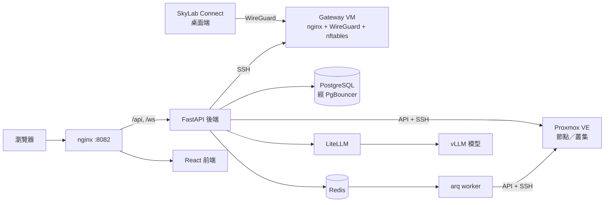

# SkyLab

**給學校用的自架雲端：學生自己申請 VM、老師一鍵開好整班的機器、管理員把 Proxmox VE 管得井井有條。**

[](https://github.com/ntubclass/SkyLab/actions/workflows/backend-tests.yml)
[](https://github.com/ntubclass/SkyLab/actions/workflows/frontend-tests.yml)
[](https://github.com/ntubclass/SkyLab/actions/workflows/codeql.yml)
[](https://github.com/ntubclass/SkyLab/blob/main/LICENSE)

SkyLab 是一個面向校園的 Proxmox VE（PVE）全端管理平台，整合 VM/LXC 生命週期管理、申請審核流程、班級批次建置、防火牆與閘道控制、AI 輔助維運，以及以自架 vLLM 模型為後盾的 OpenAI 相容 AI API。

**適用對象**：已經在用（或打算導入）Proxmox VE 的學校、系所與實驗室，想把機器發給學生與課程使用，又不想讓每個人都進 PVE 管理介面。

## 架構



## 系統組成

| 子系統 | 路徑 | 角色 |
| --- | --- | --- |
| Backend | `backend/` | FastAPI + SQLModel + PostgreSQL + Redis，串接 Proxmox API，提供 REST 與 WebSocket |
| Frontend | `frontend/` | React 19（JSX）+ Vite + react-router-dom 7 + SCSS Modules，手寫 API services |
| nginx | `nginx/` | 單一入口（預設 `:8082`）：`/api`、`/ws` → backend，其餘 → frontend |
| Gateway 安裝腳本 | `gateway/` | 校園出口閘道 VM 的 `install.sh`：nginx（Port 轉發、網域反向代理）、WireGuard、nftables ACL |
| 桌面端 | `desktop-client/` | SkyLab Connect（Electron）：裝置登入與到閘道的 WireGuard 隧道 |
| vLLM Service | `vllm-service/` | 單模型主服務、多模型 vLLM cluster，以及對外的 LiteLLM gateway |
| 監控 stack | `monitoring/` | 選用的 Prometheus / Grafana / Loki / Alloy / InfluxDB profile |
| 文件 | `website/` | 所有指南、使用手冊與 API 參考，以 VitePress 網站形式部署到 Cloudflare Pages（[docs.skylab-tw.com](https://docs.skylab-tw.com)）；索引見[文件索引](/zh-TW/guides/)，網站建置見 [`website/README.zh-TW.md`](https://github.com/ntubclass/SkyLab/blob/main/website/README.zh-TW.md) |
| 官網 | `site/` | [skylab-tw.com](https://skylab-tw.com) 介紹網站與聯繫方式，三種語言預渲染並部署到 Cloudflare Pages；見[官網](/zh-TW/operations/site) |

## 技術棧

- **後端**：FastAPI、SQLModel、Alembic、PostgreSQL（經 PgBouncer）、Redis、arq worker、proxmoxer、Paramiko、PyJWT、cryptography、httpx、websockets、Sentry
- **前端**：React 19（React Compiler）、Vite、react-router-dom 7、TanStack Query / Table / Virtual、SCSS Modules、react-i18next（en / zh-TW / ja）、noVNC、xterm.js、@xyflow/react、Recharts、Monaco Editor、sonner、Vitest
- **基礎設施**：Docker Compose、nginx、PgBouncer、PostgreSQL、Redis、MailCatcher（開發用）、選用的 Prometheus / Grafana / Loki / Alloy / InfluxDB
- **AI**：vLLM（OpenAI 相容 API）經 LiteLLM 對外，後端另內建放置建議與範本推薦
- **套件管理**：uv（Python）、Bun（前端）

## 主要功能

- VM / LXC 生命週期：建立、查詢、規格調整、快照、備份／還原、刪除
- 瀏覽器內的 VNC 與 LXC 終端機（WebSocket 代理，noVNC + xterm.js）
- VM 申請工作流：學生提交 → 審核 → 依申請時段做容量檢查 → 排程自動供應
- 範本、正式班級、課表、學生名單、多機教學環境與整班批次建置
- 班級教室監看、教師廣播，以及班級內的 AI 導師檢查
- 防火牆拓撲、NAT、反向代理（網域）規則、IP 管理，以及經 SSH 管理的閘道 VM（nginx Port 轉發／網域反向代理／管理員自備的 HTTPS 憑證／WireGuard）
- 多個 Proxmox 連線（單台或叢集），叢集內主機自動 HA failover
- 治理：TTL 漸進回收、閒置偵測、資源告警、反挖礦偵測、配額
- AI API：`ccai_*` 憑證、申請審核、Redis sliding-window 流量限制，以及 `/api/v1/ai-proxy/{models,chat/completions,completions,responses}` 的 OpenAI 相容代理（轉發到受限的 LiteLLM service key）
- 管理員專用的 AI PVE 維運助手，以及教學流程的 AI 導覽、情境說明與範本推薦
- 認證：密碼、Google、LDAP/AD、選用的逐帳號 TOTP 兩步驟驗證、Cloudflare Turnstile、登入前服務檢查
- 平台健康監控、系統告警、Web Push 推播、Prometheus `/metrics`
- 完整稽核日誌；角色：student / teacher / admin；三語系介面（en / zh-TW / ja）

## 需求

- 一台裝有 Docker Engine 與 Docker Compose ≥ 2.20 的 Linux 主機（根目錄 compose 檔用到 `include`）
- 要建機器就需要連得到的 Proxmox VE 節點或叢集；介面、登入與大部分測試不需要
- 選用：一台當 Gateway 的 Debian 13 VM（Port 轉發、網域、WireGuard），以及跑 vLLM 的 GPU 主機（AI 功能）

## 快速開始（Docker Compose）

```bash
git clone https://github.com/ntubclass/SkyLab.git
cd SkyLab
cp -n .env.example .env
cp -n vllm-service/litellm/.env.example vllm-service/litellm/.env   # 沒有用 AI stack 時 Compose 也會讀這個檔
# 編輯 .env：至少改 SECRET_KEY、FIRST_SUPERUSER、FIRST_SUPERUSER_PASSWORD、POSTGRES_PASSWORD
docker compose up -d --build --scale litellm=0
```

`--scale litellm=0` 會先略過引入的 LiteLLM 服務：AI stack 產生 `config.yaml` 之前它起不來（見下方）。接著打開 http://localhost:8082。第一次啟動時，初始化精靈（`/setup`）會建立管理員、測試 Proxmox 連線，並設定 IP 網段、Gateway 與平台入口。

預設服務位址（除了 nginx 入口，其餘都只綁 127.0.0.1）：

| 服務 | URL |
| --- | --- |
| SkyLab 入口（nginx） | http://localhost:8082 |
| Frontend 容器（建置好的靜態檔，不經 nginx） | http://localhost:5173 |
| Backend API | http://localhost:8000 |
| Swagger UI | http://localhost:8000/docs |
| MailCatcher（開發用收信匣；正式環境請設 `SMTP_HOST`） | http://localhost:1080 |
| Grafana（需 `--profile monitoring`） | http://localhost:8082/grafana/ |

### 選用：AI stack

根目錄 `docker-compose.yml` 已整合 LiteLLM。要啟用 AI 功能，先啟動 vLLM 模型（`vllm-service/start_multi_model_cluster.sh`），再用輔助腳本補齊金鑰並把整套串起來；上游金鑰、模型路由與 `models.json` 見 [AI API 使用與部署手冊](/zh-TW/guides/ai-api-user-manual)：

```bash
bash scripts/prepare-ai-stack.sh --init-env   # 補齊兩份 .env 缺少的金鑰
bash scripts/prepare-ai-stack.sh --start      # 產生 LiteLLM 設定、建立它的資料庫、核發 service key 並啟動全部服務
```

正式部署（平台入口、HTTPS、LDAP、CI）見[部署指南](/zh-TW/guides/deployment)。

## 本地開發

後端：

```bash
cd backend
uv sync                            # 虛擬環境建在 repo 根目錄（.venv）
uv run fastapi dev app/main.py     # http://localhost:8000，Swagger UI 在 /docs
```

前端：

```bash
cd frontend
bun install
bun run dev                        # http://localhost:5173，/api 由 vite proxy 轉發到 :8000
```

後端沒有自動生成的 client。所有端點都在 `frontend/src/services/*.js` 以手寫方式包裝並附 Vitest mock 測試；路由變更時要同步更新對應的 service 檔。

完整說明見[開發指南](/zh-TW/guides/development)，後端結構見[後端架構](/zh-TW/guides/backend)。

## 資料庫遷移

Schema 以 Alembic 管理。`backend/app/models/` 的任何變更都要建立遷移。遷移檔要在主機上產生：backend 容器沒有掛原始碼，寫在容器裡的檔案不會回到你的 checkout。

```bash
cd backend
export POSTGRES_SERVER=localhost POSTGRES_PORT=5433   # db 容器對主機開的埠（POSTGRES_HOST_PORT）
uv run alembic revision --autogenerate -m "Describe the change"
uv run alembic upgrade head
```

stack 啟動時 `prestart` 容器會自動執行 `alembic upgrade head`。

## 測試

- **後端**：在 `backend/` 執行 `uv run bash ./scripts/test.sh`（pytest，覆蓋率報告於 `backend/htmlcov/`）。測試不在 backend 映像裡，所以要在主機上跑，不能在容器內跑。
- **前端**：在 `frontend/` 執行 `bun run test`（Vitest）
- **CI**：GitHub Actions 跑後端測試、前端測試、桌面端測試、AI service 測試、migration 檢查與 CodeQL

## Proxmox 設定

PVE 連線**不在** `.env` 設定。首次安裝時在初始化精靈填入，之後由管理員在「PVE 管理」頁新增、編輯或同步；連線資訊加密存進資料庫。可同時接多個 PVE 入口（單台或叢集），叢集內多台主機會自動 failover（TCP ping 偵測）。

## 文件

所有文件都在 repo 的 `website/` 目錄，發布成本文件網站（建置與 Cloudflare Pages 部署見 [`website/README.zh-TW.md`](https://github.com/ntubclass/SkyLab/blob/main/website/README.zh-TW.md)）。索引是[文件索引](/zh-TW/guides/)，英文頁在 `website/` 下、繁體中文頁在 `website/zh-TW/` 下。常用項目：

- [快速開始](/zh-TW/getting-started) — 從 `docker compose up` 到初始化精靈與第一次登入
- [使用手冊](/zh-TW/manual/) — 每個功能一頁，依角色（學生、老師、管理員）分組
- [開發指南](/zh-TW/guides/development) — 開發環境
- [部署指南](/zh-TW/guides/deployment) — 正式部署、平台入口、HTTPS 憑證、LDAP
- [升級與 migration](/zh-TW/operations/upgrade)、[備份與還原](/zh-TW/operations/backup) — 升級、遷移、備份與還原
- [系統監控](/zh-TW/guides/monitoring) — 內建健康監控與選用的監控 stack
- [AI API 使用與部署手冊](/zh-TW/guides/ai-api-user-manual) — LiteLLM 部署與對外 AI API
- [多機教學環境 SOP](/zh-TW/guides/multi-machine-environment-sop) — 多機教學環境 SOP
- [疑難排解](/zh-TW/troubleshooting) — 已知故障、原因與解法

## 社群

- **問題與 bug 回報**：[GitHub Issues](https://github.com/ntubclass/SkyLab/issues)（請使用範本）
- **貢獻**：請先讀 [`CONTRIBUTING.zh-TW.md`](https://github.com/ntubclass/SkyLab/blob/main/CONTRIBUTING.zh-TW.md)；所有 commit 都要 DCO sign-off（`git commit -s`）
- **安全問題**：請勿開公開 issue，依 [`SECURITY.zh-TW.md`](https://github.com/ntubclass/SkyLab/blob/main/SECURITY.zh-TW.md) 回報
- **行為準則**：[`CODE_OF_CONDUCT.zh-TW.md`](https://github.com/ntubclass/SkyLab/blob/main/CODE_OF_CONDUCT.zh-TW.md)

## 授權

SkyLab 以 **GNU Affero General Public License v3.0** 釋出（見 [`LICENSE`](https://github.com/ntubclass/SkyLab/blob/main/LICENSE)）。

- 在校內或組織內自行部署使用，不論有沒有改程式，除授權本身的條款外沒有其他義務。
- 若你修改了 SkyLab 並讓第三方透過網路使用（例如代管或託管服務），AGPL 要求你向那些使用者提供修改後的原始碼。
- 想把 SkyLab 當作服務提供、但不希望受 AGPL 原始碼公開條款約束，或需要其他條件的組織，可洽談**商業授權**。請開 issue 或聯絡維護者。

本專案源自 MIT 授權的 Full Stack FastAPI Template，桌面端則源自 MIT 授權的 Electron + Vue 範本，兩者的聲明保留在 [`NOTICE`](https://github.com/ntubclass/SkyLab/blob/main/NOTICE)；SkyLab 所用的開源元件列在 [`THIRD_PARTY_NOTICES.md`](https://github.com/ntubclass/SkyLab/blob/main/THIRD_PARTY_NOTICES.md)，應用程式內的「帳號設定 → 關於」也會顯示同樣的資訊。「SkyLab」名稱與標誌屬於本專案；授權涵蓋的是程式碼，不是名稱。
